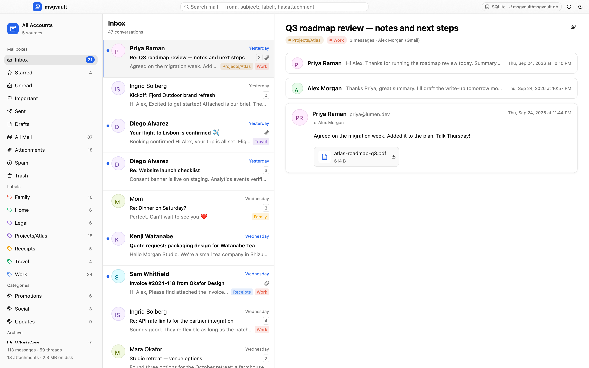
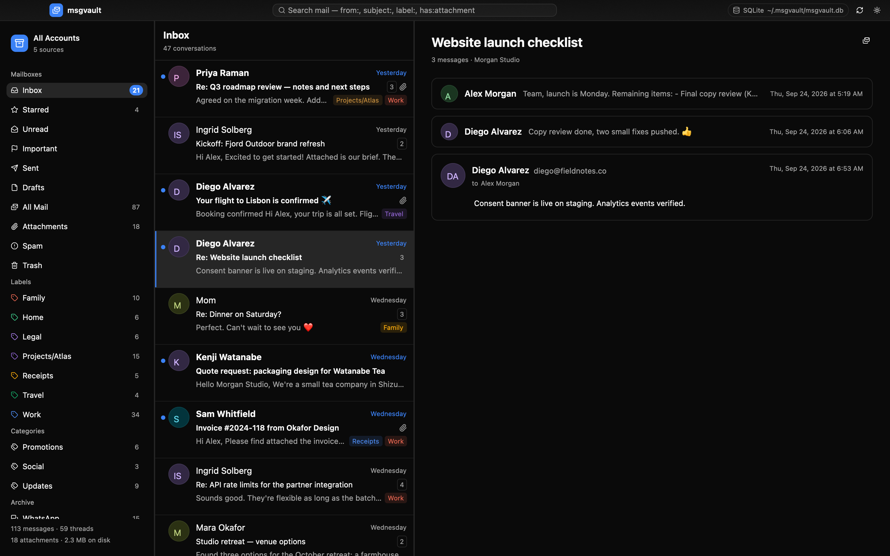
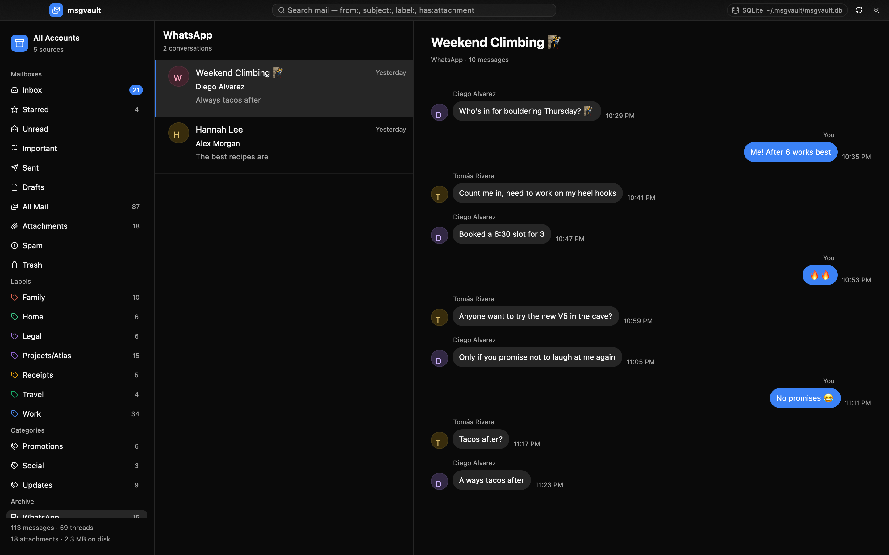

# msgvault-gpui

[](https://github.com/penso/msgvault-gpui/actions/workflows/ci.yml)
[](LICENSE)
[](rust-toolchain.toml)
[](https://github.com/longbridge/gpui-kit)

A native, GPU-rendered mail client for browsing a
[msgvault](https://github.com/wesm/msgvault) archive: every account, label,
thread, chat, calendar entry and attachment msgvault has stored. It is
built with [GPUI](https://www.gpui.rs) and [gpui-kit](https://github.com/longbridge/gpui-kit).



| Dark mode | Chats |
| --- | --- |
|  |  |

The app only reads the archive. It never writes to msgvault's database or
attachments.

## Features

- A three-pane layout with resizable panes: sidebar, conversation list and
  reader.
- **Sidebar:**
  - Standard mailboxes: Inbox, Starred, Unread, Important, Sent, Drafts, All
    Mail, Attachments, Spam and Trash.
  - Colored user labels and Gmail categories.
  - Non-email sources (WhatsApp, Slack, calendar, …) and messages that were
    deleted from the provider but are still archived.
  - An account switcher.
- **Conversation list:**
  - One row per thread, with unread and starred state, attachment and
    thread-count badges, and label chips.
  - Loads more rows as you scroll.
- **Reader:**
  - Gmail-style threads: earlier messages collapse to one line.
  - HTML mail rendering, with a plain-text toggle.
  - Selectable text.
  - Attachments open in the default app (<kbd>click</kbd>) or save to
    Downloads.
  - Chats appear as message bubbles.
- **Search** uses msgvault's Gmail-like syntax: free text (full-text, prefix
  matching), `from:`, `to:`, `subject:`, `label:`, `has:attachment`,
  `is:unread`, `is:starred`, `before:` and `after:`.
- Follows the system light/dark appearance, with a manual toggle.
- Keyboard shortcuts:

  | Keys | Action |
  | --- | --- |
  | <kbd>j</kbd> / <kbd>k</kbd> or the arrow keys | Move through messages |
  | <kbd>/</kbd> or <kbd>⌘F</kbd> | Search |
  | <kbd>Esc</kbd> | Clear search |
  | <kbd>;</kbd> | Expand the whole thread |
  | <kbd>⌘1</kbd>–<kbd>⌘4</kbd> | Inbox, Starred, Sent, All Mail |
  | <kbd>⌘R</kbd> | Refresh |
  | <kbd>⌘⇧L</kbd> | Toggle dark mode |
  | <kbd>⌘⇧H</kbd> | Toggle rich text |

## How it reaches msgvault

msgvault is written in Go and has no embeddable library, so `msgvault-core`
provides two interchangeable backends behind one `Backend` trait:

| Backend | When it's used | Notes |
| --- | --- | --- |
| **Daemon** (`HttpBackend`) | A `msgvault serve` daemon is reachable | Uses the daemon's versioned REST API (`api/openapi.yaml`). The daemon is found through `<data_dir>/daemon.<pid>.json`, `[server] api_port`, or `[remote] url` / `--url`. |
| **SQLite** (`SqliteBackend`) | No daemon is running | Opens `msgvault.db` directly and read-only (`PRAGMA query_only`; WAL-safe). Search uses FTS5. Raw MIME is decoded when an archive has no parsed body. Attachments are read from loose content-addressed blobs and from zstd-compressed `.mvpack` packs, and are verified against their SHA-256. |

By default the app tries the daemon first and falls back to
the database file. The archive location follows msgvault's own rules:
`$MSGVAULT_HOME`, otherwise `~/.msgvault`, with `[data] data_dir` read from
`config.toml`.

## Running

Requirements:
- The Rust toolchain pinned in `rust-toolchain.toml`; rustup installs it
  automatically.
- [`just`](https://github.com/casey/just) (optional).
- On Linux, GPUI's system libraries. The CI workflow lists the Ubuntu
  packages.

```sh
git clone https://github.com/penso/msgvault-gpui
cd msgvault-gpui
just demo                 # try it on a generated archive
```

`just` recipes wrap the common commands:

```sh
just run                  # your archive (~/.msgvault or $MSGVAULT_HOME)
just demo                 # a generated demo archive
just run --home /path     # another archive
just run --sqlite         # never use the daemon
just run --url http://nas.local:8080 --api-key KEY
```

With no archive, the app opens a welcome screen that can create a demo archive.

## Development

```sh
just format               # nightly rustfmt + taplo
just ci                   # format checks, lockfile, clippy -D warnings, tests
just deny                 # cargo-deny: licenses, advisories, bans, sources
just fixture demo-archive # write a synthetic archive
just screenshots          # re-render docs/screenshots headlessly (Metal)
```

- **Fixtures.** `msgvault-core/src/fixture.rs` builds archives from
  msgvault's real schema, vendored in `crates/msgvault-core/schema/` under
  msgvault's MIT license. The SQLite reader is therefore tested against
  production DDL.
- **Upstream schema changes.** Refresh the vendored copy with `just
  vendor-schema ../msgvault`.
- **Screenshots.** Screenshot mode (`--features screenshot`) renders the real
  window through gpui's headless Metal renderer, so the UI can be reviewed
  without a display session.

| Crate | Responsibility |
| --- | --- |
| `crates/msgvault-core` | Archive discovery, the `Backend` trait, the SQLite and daemon readers, and fixtures. No UI dependencies. |
| `crates/msgvault-gpui` | The GPUI application: state, background loading, and views. |

## License

MIT, see [LICENSE](LICENSE). The vendored msgvault schema in
`crates/msgvault-core/schema/` is © Wes McKinney, also under the MIT license
(`LICENSE-msgvault`). msgvault-gpui is an independent project and isn't
affiliated with msgvault.
